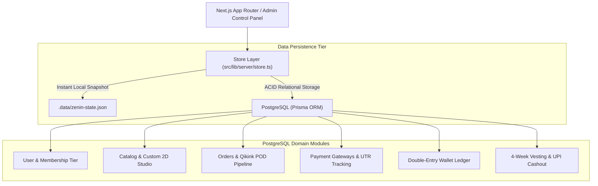
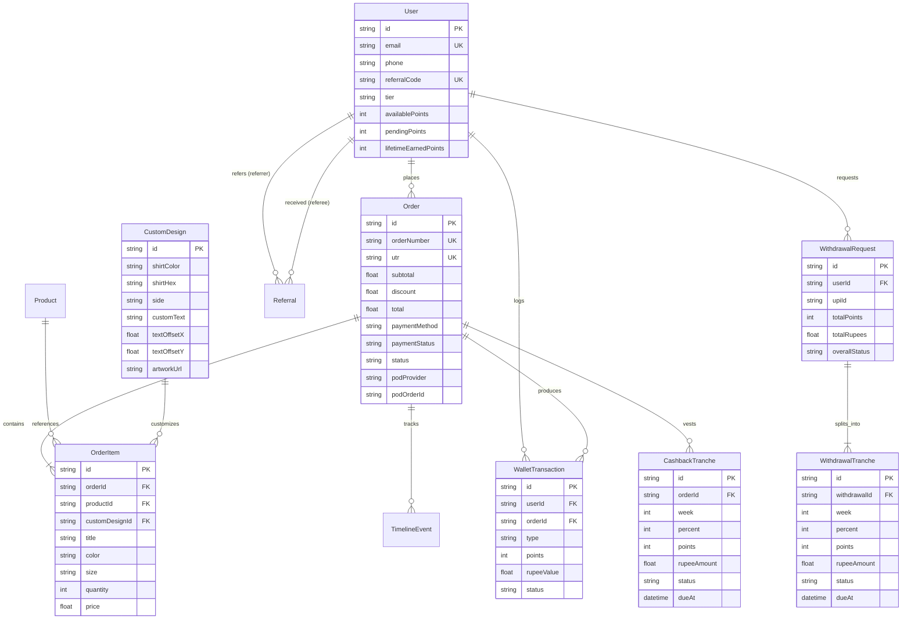

# 🗄️ SKYWEAR — Database Architecture & Design Specification
> **Document Version:** 1.0.0  
> **Target Engine:** PostgreSQL 16+ / 18+ (Local & Production Cloud)  
> **ORM & Schema Contract:** Prisma (`prisma/schema.prisma`)  
> **State Fallback:** JSON State Store (`.data/zenin-state.json`) via `src/lib/server/store.ts`

---

## 📌 1. Executive Summary & Architectural Philosophy

SKYWEAR's database is engineered around a **Triple-Engine Model**:
1. **D2C Streetwear Storefront Engine**: Heavyweight 240+ GSM apparel catalog, size matrices, and product reviews.
2. **Interactive 2D Customizer Studio**: User-generated custom typography, coordinate offsets, and vector artwork placement.
3. **Fintech Loyalty & 4-Week Anti-Fraud Vesting Engine**: Double-entry ledger for ZENIN reward coins, referral tracking, and timed UPI bank payouts.

### Hybrid 2-Tier Persistence Strategy



- **Resilience**: The app remains functional offline or during local database reboots via `.data/zenin-state.json`.
- **Integrity**: Financial ledger entries (`WalletTransaction`), UTR uniqueness, and order statuses enforce strict foreign keys, unique constraints, and optimistic locking (`revision`).

---

## 🗺️ 2. Entity Relationship Diagram (ERD)



---

## 🧩 3. Core Domain Modules

### Module 1: User & Authentication Engine (`User`)
*Manages customer profiles, loyalty tiers, phone/email verification, and live point balances.*

```prisma
model User {
  id                   String              @id @default(cuid())
  name                 String
  email                String              @unique
  phone                String?
  role                 Role                @default(CUSTOMER)
  referralCode         String              @unique
  referredByCode       String?
  tier                 String              @default("Silver") // Silver -> Gold -> Black Archive
  availablePoints      Int                 @default(0)       // Ready for checkout or cashout
  pendingPoints        Int                 @default(0)       // Currently in vesting lock
  lifetimeEarnedPoints Int                 @default(0)       // Total reward history
  addresses            Json                @default("[]")
  createdAt            DateTime            @default(now())
  updatedAt            DateTime            @updatedAt
}
```

- **Tiers**:
  - `Silver`: Standard tier (10% cashback).
  - `Gold`: 15+ orders or ₹10,000+ spend (12% cashback + priority POD queue).
  - `Black Archive`: VIP streetwear collectors (15% cashback + exclusive drop access).

---

### Module 2: Streetwear Catalog & Customizer Studio (`Product`, `CustomDesign`)

#### A. Standard Catalog (`Product`)
Designed for authentic heavyweight streetwear specifications:
- `gsm`: Default `240` (Heavyweight French Terry / Super-Combed Cotton).
- `colors`: JSON array containing name, hex value, and Tailwind preview classes.
- `sizes`: String array `["S", "M", "L", "XL", "XXL"]`.
- `cashbackPoints`: Exact coins rewarded upon purchasing this item.

#### B. Interactive 2D Studio (`CustomDesign`)
Stores exact client-side canvas coordinates for manufacturing:
- `shirtColor` & `shirtHex`: Base tee fabric color.
- `side`: `"front"` or `"back"` view.
- `customText`, `fontFamily`, `textColor`, `textSize`: User typography attributes.
- `textOffsetX`, `textOffsetY`: Normalized drag-and-drop vector offsets.
- `artworkUrl`: High-resolution transparent PNG/SVG for the print head.

---

### Module 3: Order Lifecycle & POD Fulfillment (`Order`, `OrderItem`, `TimelineEvent`)

#### Order Pipeline State Machine
```
[PENDING] 
   │
   ├── (Payment Verified / COD OTP Confirmed)
   ▼
[APPROVED]
   │
   ├── (Webhook triggered to Qikink API)
   ▼
[PRINTING_POD] (240 GSM Bio-Washed Direct-to-Film Print)
   │
   ├── (AWB generated: BlueDart / Delhivery / DTDC)
   ▼
[SHIPPED]
   │
   ├── (Delivery Handover)
   ▼
[DELIVERED] ──> Triggers 4-Week Cashback Vesting Engine
```

#### Order Entity Highlights:
- `utr`: Unique 12-digit bank reference for direct UPI payments (prevents double-spending).
- `paymentScreenshot`: Customer receipt uploaded for manual reconciliation.
- `podProvider`: Fulfillment vendor (default: `Qikink`).
- `podOrderId`: External supplier dispatch identifier.

---

### Module 4: Double-Entry Immutable Wallet Ledger (`WalletTransaction`)

To prevent coin balance tampering or desync, point balances are **derived and audited** via an immutable ledger:

```prisma
model WalletTransaction {
  id          String            @id @default(cuid())
  userId      String?
  orderId     String?
  orderNumber String?
  type        TransactionType   // CASHBACK, REFERRAL_COMMISSION, REDEMPTION, REFUND, ADMIN_ADJUSTMENT
  points      Int               // Signed value (+100 or -50)
  rupeeValue  Float             // Standard parity (e.g. 1 Point = ₹0.50)
  description String
  status      TransactionStatus @default(COMPLETED) // PENDING, COMPLETED, REVERSED
  createdAt   DateTime          @default(now())
}
```

---

### Module 5: 4-Week Anti-Fraud Vesting Engine (`CashbackTranche`, `WithdrawalTranche`)

In Indian D2C streetwear, Return-To-Origin (RTO) and buyer return abuse cause significant margin leakage. Skywear implements a **staggered release model**:

#### A. Order Cashback Vesting (`CashbackTranche`)
When an order is delivered, cashback unlocks across 4 tranches:
1. **Week 1 (Day 0 - Delivery Confirmation)**: 25% points unlock instantly.
2. **Week 2 (Day 7 - Return window closed)**: 25% points unlock.
3. **Week 3 (Day 14)**: 25% points unlock.
4. **Week 4 (Day 21)**: Remaining 25% points unlock.

#### B. Direct UPI Bank Payouts (`WithdrawalRequest` & `WithdrawalTranche`)
- Unlocked coins can be transferred directly to the user's UPI ID (`upiId`).
- Admin approves payouts via `/admin` portal.
- Tranches track the financial status: `VESTING_IN_PROGRESS` $\to$ `SUBMITTED_TO_BANK` $\to$ `PAID`.

---

## ⚡ 4. Database Initialization & Local Setup

### SQL Migration Script
The raw PostgreSQL schema is pre-written in [`prisma/init-schema.sql`](file:///c:/Users/aakas/Desktop/skywear/prisma/init-schema.sql).

To load it locally once PostgreSQL credentials are provided:
```bash
# 1. Create local database
psql -U postgres -h localhost -c "CREATE DATABASE skywear_dev;"

# 2. Execute schema initialization
psql -U postgres -h localhost -d skywear_dev -f prisma/init-schema.sql

# 3. Seed product catalog and initial admin
node scripts/seed-products.mjs
```

### Environment Configuration (`.env.local`)
```env
# Local PostgreSQL configuration
DATABASE_URL="postgresql://postgres:<PASSWORD>@localhost:5432/skywear_dev"
DATABASE_URL_UNPOOLED="postgresql://postgres:<PASSWORD>@localhost:5432/skywear_dev"
STUDIO_DATABASE_URL="postgresql://postgres:<PASSWORD>@localhost:5432/skywear_dev"
```

---

## 🛡️ 5. Data Integrity & Security Directives

1. **Anti-Collusion Referral Guard**: Self-referrals are blocked by ensuring `referredByCode != user.referralCode`.
2. **Double-Spend Protection**: The `utr` field is `@unique` with a B-Tree index; duplicate UTR submissions are rejected at the database level.
3. **Audit Trail**: Every admin status modification, refund, and coin adjustment records an `AuditLog` entry with timestamp and admin identifier.

