# 🏛️ ZENIN STREETWEAR — PRODUCTION SYSTEM DESIGN SPECIFICATION
> **Document Status:** Architectural Standard • **Version:** 2.0.0 • **Last Updated:** October 2026  
> **Authors:** Senior Systems Architect & Core Platform Engineering Team

---

## 📑 Table of Contents
1. [Executive Summary & Domain Context](#1-executive-summary--domain-context)
2. [Functional & Non-Functional Requirements](#2-functional--non-functional-requirements)
3. [High-Level Architecture (C4 Model)](#3-high-level-architecture-c4-model)
   - [3.1 Level 1: System Context Diagram](#31-level-1-system-context-diagram)
   - [3.2 Level 2: Container Diagram](#32-level-2-container-diagram)
   - [3.3 Level 3: Component Architecture](#33-level-3-component-architecture)
4. [Domain Model & Database Schema (PostgreSQL & Prisma)](#4-domain-model--database-schema)
   - [4.1 Complete Entity Relationship Diagram (ERD)](#41-complete-entity-relationship-diagram-erd)
   - [4.2 Data Dictionaries & Enum Definitions](#42-data-dictionaries--enum-definitions)
5. [Core State Machines](#5-core-state-machines)
   - [5.1 E-Commerce & POD Fulfillment State Machine](#51-e-commerce--pod-fulfillment-state-machine)
   - [5.2 4-Week Cashback Accrual Vesting Lifecycle](#52-4-week-cashback-accrual-vesting-lifecycle)
   - [5.3 4-Week Coin Payout / UPI Withdrawal Lifecycle](#53-4-week-coin-payout--upi-withdrawal-lifecycle)
6. [Detailed Workflows & Sequence Diagrams](#6-detailed-workflows--sequence-diagrams)
   - [6.1 Checkout, Razorpay Payment & Webhook Idempotency](#61-checkout-razorpay-payment--webhook-idempotency)
   - [6.2 4-Week Fractional Vesting Release Engine](#62-4-week-fractional-vesting-release-engine)
   - [6.3 Payout Request, Parallel Execution & Rejection-Refund Protocol](#63-payout-request-parallel-execution--rejection-refund-protocol)
   - [6.4 Stealth Admin Portal & Zero-Footprint Customer Impersonation](#64-stealth-admin-portal--zero-footprint-customer-impersonation)
7. [Financial Safety, Concurrency & Invariants](#7-financial-safety-concurrency--invariants)
   - [7.1 Double-Spend Prevention & Parallel Payout Aperture](#71-double-spend-prevention--parallel-payout-aperture)
   - [7.2 Ledger Immutability & Double-Entry Accounting](#72-ledger-immutability--double-entry-accounting)
   - [7.3 Order Cancellation & Clawback Guarantees](#73-order-cancellation--clawback-guarantees)
8. [Performance, Caching & Scalability Strategy](#8-performance-caching--scalability-strategy)
9. [Security, Authentication & Threat Modeling](#9-security-authentication--threat-modeling)
10. [Observability, Alerting & Reliability](#10-observability-alerting--reliability)
11. [Infrastructure, CI/CD & Deployment Topology](#11-infrastructure-cicd--deployment-topology)

---

## 1. Executive Summary & Domain Context

**Zenin Streetwear** (internally *Threadcraft*) is a high-performance, direct-to-consumer (D2C) Print-On-Demand (POD) streetwear platform built with an editorial, minimalist aesthetic inspired by luxury Japanese and neo-cyberpunk streetwear labels.

The platform marries three distinct operational pillars:
1. **Ultra-Responsive Customer Storefront (`/`)**: Mobile-first luxury e-commerce catalog featuring 240 GSM bio-washed heavy cotton oversized t-shirts, an interactive 2D in-browser canvas customization studio, slide-over cart drawer, and seamless Razorpay checkout.
2. **Dual-Tier Financial Rewards & 4-Week Vesting Protocol**:
   - **Cashback Accrual Layer**: 10% cash equivalent reward on purchases split into four 25% tranches: Tranche 1 unlocks instantly upon payment verification; Tranches 2, 3, and 4 auto-unlock weekly on Days 7, 14, and 21.
   - **Coin Withdrawal Protocol**: Accumulated reward coins can be liquidated directly into Indian Rupees via UPI (`@oksbi`, `@okhdfcbank`, `@paytm`, etc.) or NEFT/IMPS bank transfers, distributed across a strict 4-week vesting schedule (25% every 7 days) anchored to purchase dates.
   - **Instant Affiliate Commissions**: 10% instant affiliate commission credited directly to available wallet balances upon friend's order payment.
3. **Isolated Zero-Footprint Admin Back-Office (`/admin`)**: A completely decoupled back-office portal hidden from public discovery (0 references in client bundles or public navigation), managing the entire Qikink POD fulfillment lifecycle, courier dispatching (BlueDart, Delhivery, DTDC), custom drop creation with per-item cashback multipliers, free VIP t-shirt allocations, customer session impersonation, and batch UPI payout execution.

---

## 2. Functional & Non-Functional Requirements

### 2.1 Functional Requirements
- **FR-01 Product Discovery & Customization**: Shoppers can browse drops filtered by category, select color/size, and launch an interactive 2D Studio to customize front/back graphics and typography, rendering real-time composite previews.
- **FR-02 Cart & Checkout**: Slide-over drawer with real-time coupon calculations (`ZENIN-10`, `OVERSIZED`), wallet coin redemption (up to 30% checkout total; minimum ₹499 order), and free delivery threshold progress indicators.
- **FR-03 Payment Gateway Integration**: Native Razorpay integration supporting UPI, Credit/Debit cards, NetBanking, and COD, backed by cryptographic signature verification (`HMAC-SHA256`) and idempotent webhook processing.
- **FR-04 Dual 4-Week Vesting Financial Engine**:
  - Auto-schedule and auto-release 4-week cashback tranches.
  - Upfront coin deduction upon withdrawal creation to enable risk-free **parallel payouts**.
  - Settle, partial-pay, reject-with-auto-refund, and safely reopen payout requests.
- **FR-05 POD Fulfillment Automation**: Automated dispatch to Qikink Direct-to-Garment (DTG) printing lines, state synchronization, and multi-courier tracking (Delhivery, BlueDart, DTDC).
- **FR-06 Stealth Admin & Customer Impersonation**: Secure session-based back-office supporting instant shopper impersonation for customer support without leaving footprints or banners on the storefront.

### 2.2 Non-Functional Requirements & Engineering SLOs

| Metric | Target SLA / SLO | Architecture Enabler |
|---|---|---|
| **Catalog Time-to-First-Byte (TTFB)** | `< 120 ms` globally | Next.js Edge CDN caching + Incremental Static Regeneration (ISR) |
| **P99 Cart & Checkout Latency** | `< 250 ms` | In-memory atomic mutations + connection-pooled PostgreSQL queries |
| **Financial Ledger Consistency** | `Strict Serializability (100%)` | ACID transactions, append-only ledger, atomic balance updates |
| **Double-Spend Prevention** | `Zero Tolerance (0 violations)` | Immediate upfront balance lock, DB constraints, optimistic locking |
| **Webhook Idempotency Window** | `7 Days` | Idempotency key tracking on `gatewayOrderId` & `gatewayPaymentId` |
| **Admin Route Secrecy** | `Zero Footprint` | Isolated bundle chunking, 0 DOM references, separate cookie auth |
| **Database RPO & RTO** | `RPO < 1 min, RTO < 5 min` | WAL streaming replication, automated point-in-time recovery (PITR) |

---

## 3. High-Level Architecture (C4 Model)

### 3.1 Level 1: System Context Diagram

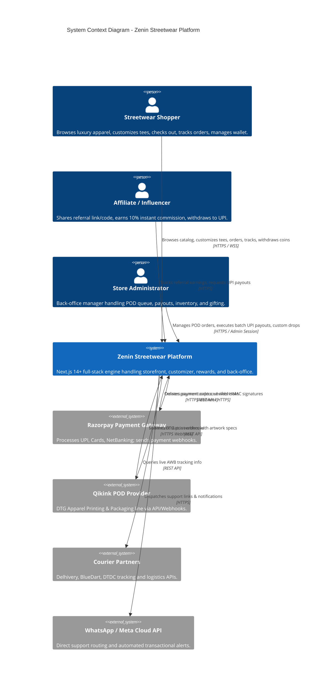

---

### 3.2 Level 2: Container Diagram

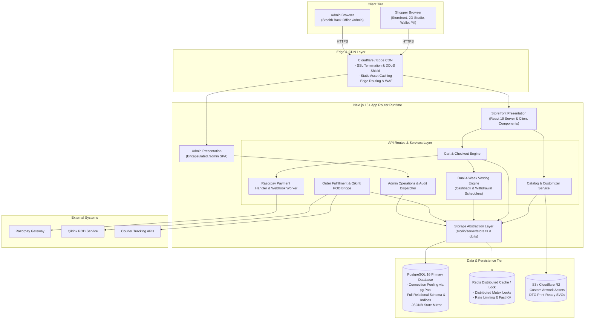

---

### 3.3 Level 3: Component Architecture

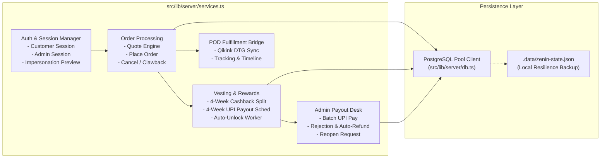

---

## 4. Domain Model & Database Schema

### 4.1 Complete Entity Relationship Diagram (ERD)

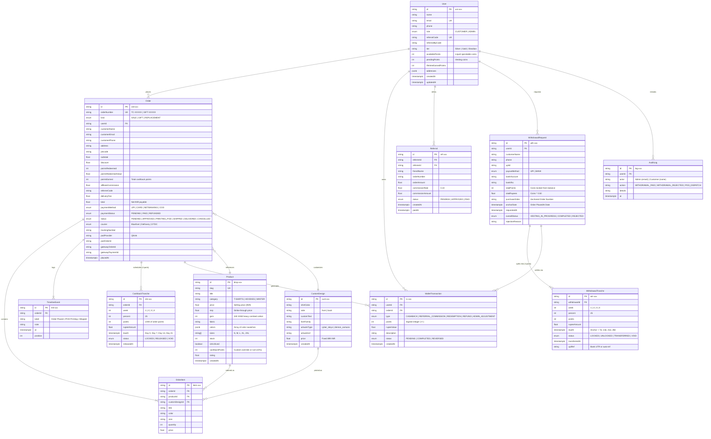

---

## 5. Core State Machines

### 5.1 E-Commerce & POD Fulfillment State Machine

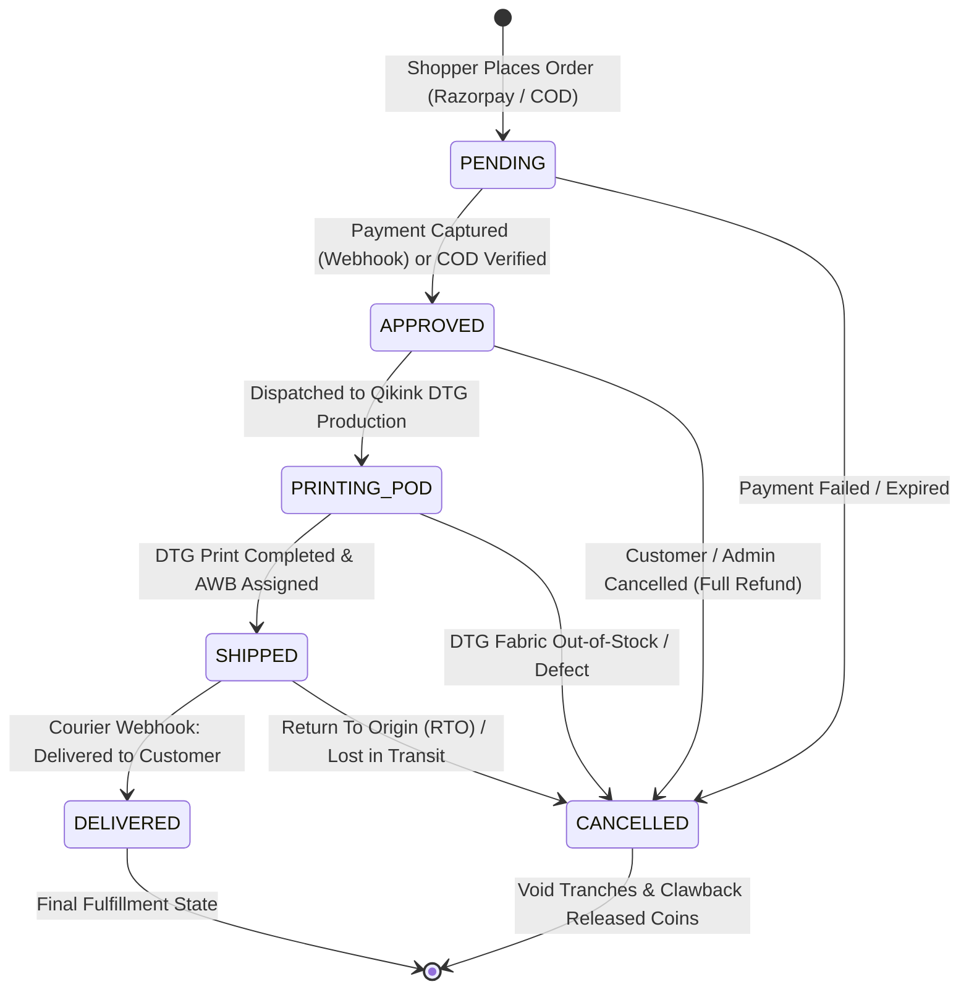

---

### 5.2 4-Week Cashback Accrual Vesting Lifecycle

Cashback calculation rule: **Every ₹100 spent = 20 Zenin Points (₹10 value = 10% effective reward)**.

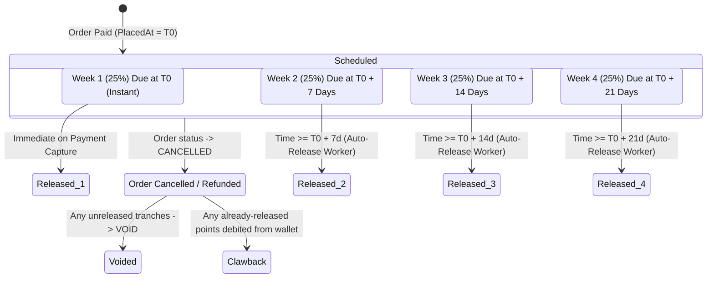

---

### 5.3 4-Week Coin Payout / UPI Withdrawal Lifecycle

Withdrawals are governed by a strict financial security protocol where coins are **deducted upfront from the member's wallet** at the time the request is created.

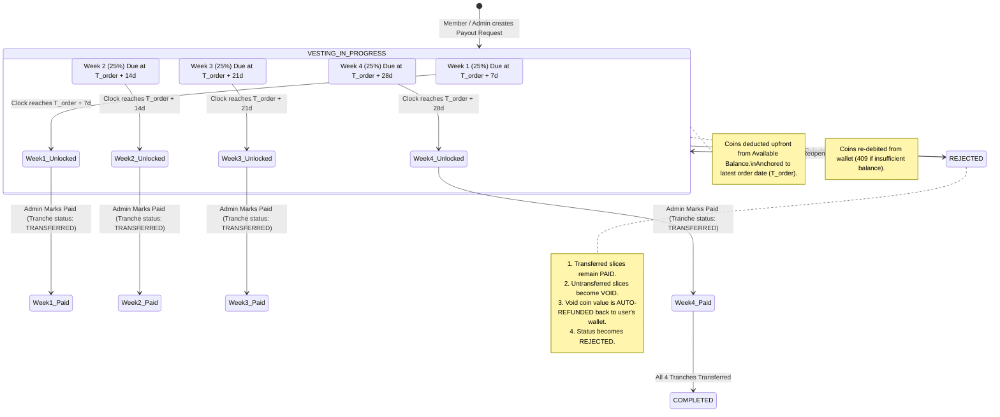

---

## 6. Detailed Workflows & Sequence Diagrams

### 6.1 Checkout, Razorpay Payment & Webhook Idempotency

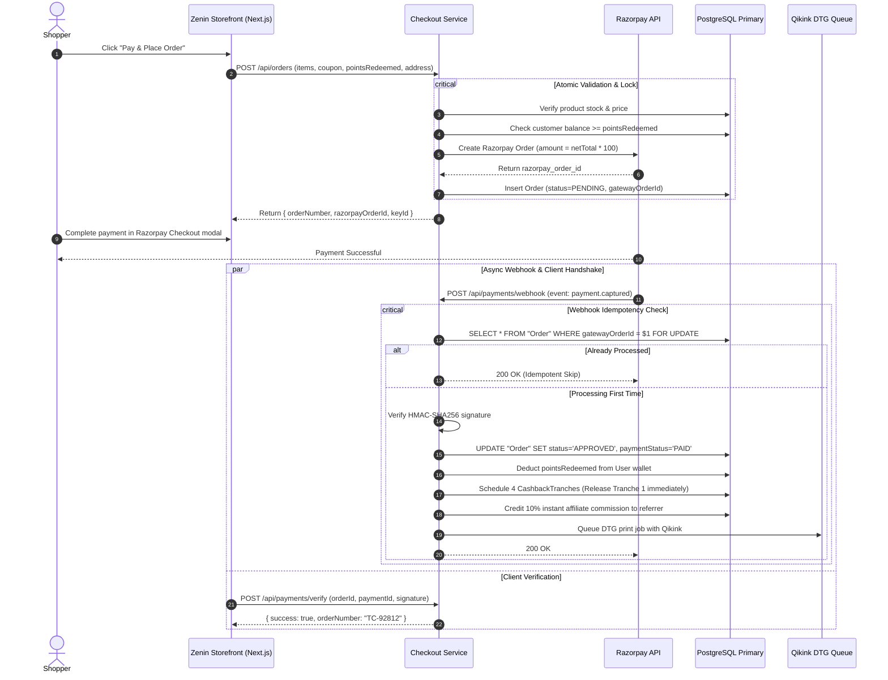

---

### 6.2 4-Week Fractional Vesting Release Engine

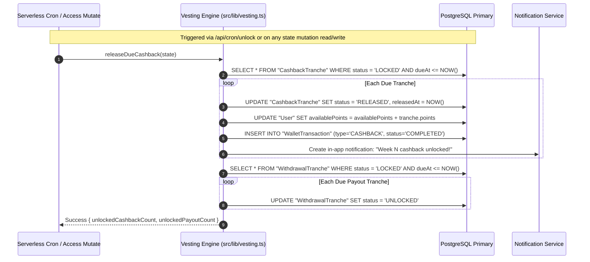

---

### 6.3 Payout Request, Parallel Execution & Rejection-Refund Protocol

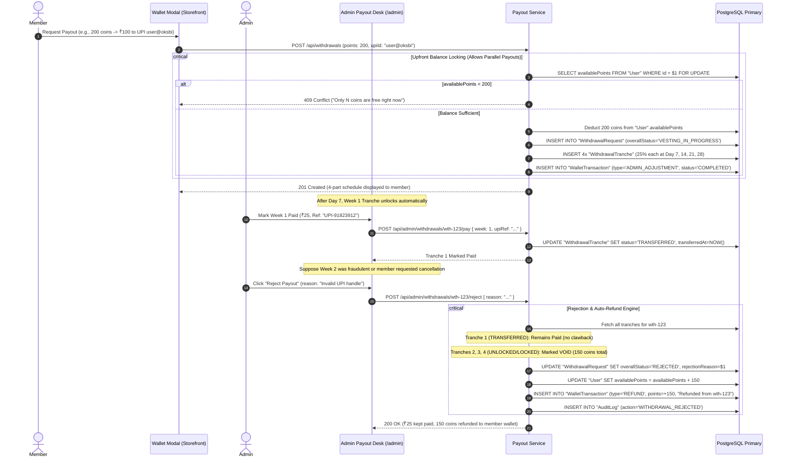

---

### 6.4 Stealth Admin Portal & Zero-Footprint Customer Impersonation

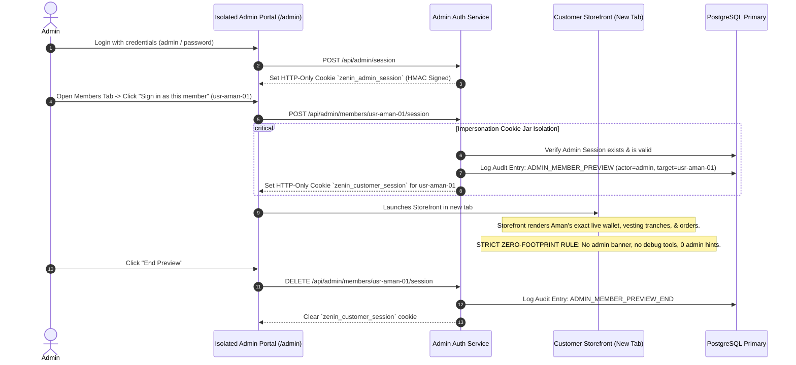

---

## 7. Financial Safety, Concurrency & Invariants

### 7.1 Double-Spend Prevention & Parallel Payout Aperture

A critical engineering vulnerability in rewards platforms is the **double-spend attack**, where a user requests multiple concurrent withdrawals before previous requests complete their vesting cycles.

**Zenin's Architectural Solution:**
1. **Immediate Upfront Balance Deduction**: The moment `submitWithdrawal` or `adminRaiseWithdrawal` is executed, the entire requested coin amount is atomically subtracted from `User.availablePoints`.
2. **Independent Vesting Envelopes**: Because coins are already removed from the liquid balance, multiple payouts can run **in parallel** side-by-side without competing for the same pool of coins.
3. **Pessimistic Row-Level Locking**: In PostgreSQL, all wallet mutations run within transactions using `SELECT ... FOR UPDATE` on the `User` row:
   ```sql
   BEGIN;
   SELECT "availablePoints" FROM "User" WHERE "id" = $1 FOR UPDATE;
   -- Validate availablePoints >= requestedPoints
   UPDATE "User" SET "availablePoints" = "availablePoints" - $2 WHERE "id" = $1;
   INSERT INTO "WithdrawalRequest" (...);
   COMMIT;
   ```

### 7.2 Ledger Immutability & Double-Entry Accounting

- The `WalletTransaction` table is **append-only**. Rows are never modified or deleted.
- If a withdrawal is cancelled or rejected, a corresponding `REFUND` transaction row is appended.
- If an order is cancelled, a `REVERSED` transaction row is appended.
- Mathematical Invariant:
  $$\text{User.availablePoints} = \sum \text{Earned Points} - \sum \text{Redeemed Points} - \sum \text{Locked In Payouts} + \sum \text{Refunded Points}$$

### 7.3 Order Cancellation & Clawback Guarantees

When an order status changes to `CANCELLED`:
1. **Unreleased Cashback Tranches** (`status = 'LOCKED'`) are immediately set to `VOID`.
2. **Released Cashback Tranches** (`status = 'RELEASED'`) represent coins already credited to the user's wallet:
   - The engine issues a debit `ADMIN_ADJUSTMENT` ledger entry clawing back those points.
   - If the user's balance drops below zero, the wallet balance reflects the deficit and recovers on subsequent purchases.
3. **Affiliate Referral Commissions**:
   - The referrer's commission status transitions from `PAID` to `REVERSED`.
   - A reversal entry is written to the referrer's ledger, deducting the commission points.

---

## 8. Performance, Caching & Scalability Strategy

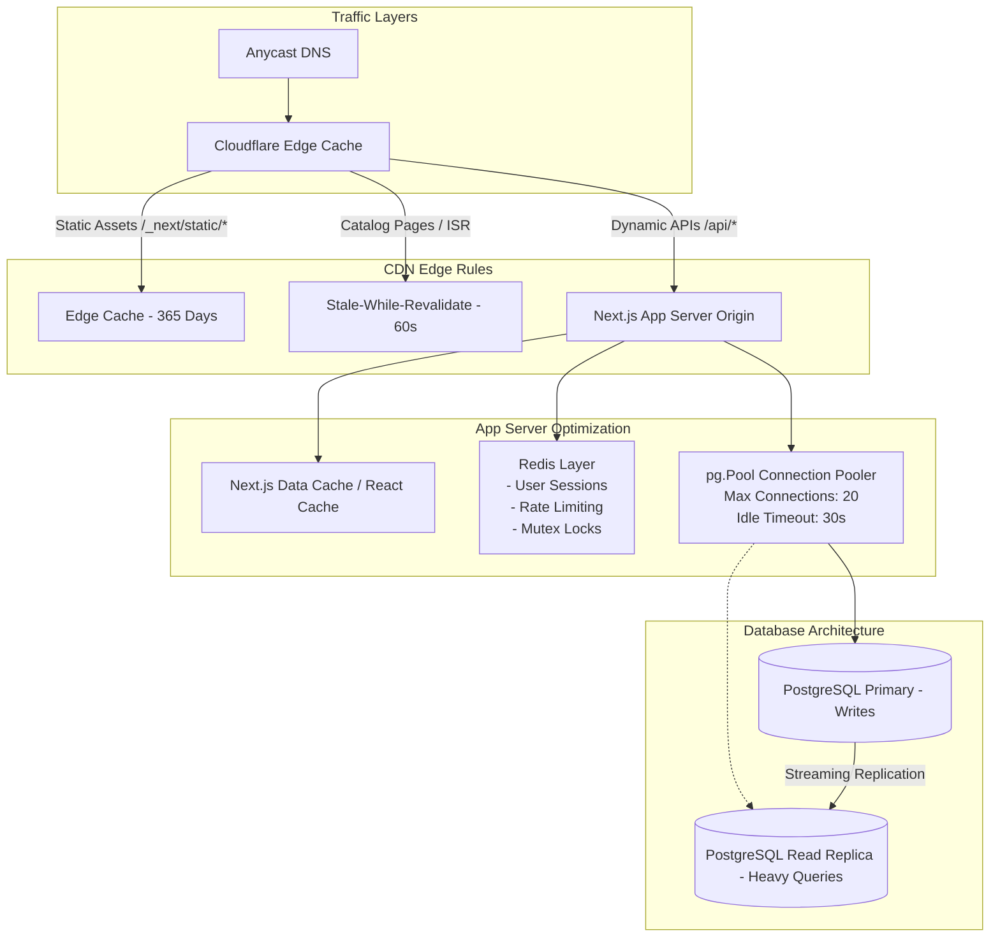

### 8.1 Caching Tiers
1. **Edge CDN Layer**: All images, fonts, static JS bundles, and pre-rendered catalog product pages (`/products/[slug]`) are cached globally at the edge with `stale-while-revalidate=86400`.
2. **Next.js Route Cache**: Category navigation and support snapshots are cached in-memory and revalidated on demand when an administrator publishes a new drop or updates support numbers.
3. **Database Connection Pool**: Managed via `pg.Pool` with connection reuse, preventing TCP handshake overhead and protecting PostgreSQL from connection exhaustion during high-concurrency drop events.

---

## 9. Security, Authentication & Threat Modeling

### 9.1 Zero-Footprint Stealth Admin Architecture
- **No Public Trace**: The `/admin` portal contains 0 navigational links, buttons, meta headers, or references on the public storefront.
- **Route Protection**: All administrative endpoints (`/api/admin/*`) strictly validate the presence and cryptographic signature of the `zenin_admin_session` cookie via `readAdminSession()`.
- **Payload Verification**: Rejections, status changes, and payout marks validate role permissions before executing any DB mutations.

### 9.2 Input Sanitization & Validation Matrix

| Input Field | Validation Regex / Rule | Defense Mechanism |
|---|---|---|
| **Indian Mobile** | `/^(\+91[\s-]?)?[6-9]\d{9}$/` | Rejects malformed numbers; standardizes to 10 digits |
| **Indian Pincode** | `/^[1-9]\d{5}$/` | Validates postal code format |
| **UPI ID** | `/^[\w.\-]{2,256}@[a-zA-Z]{2,64}$/` | Prevents injection; ensures valid VPA routing |
| **Rejection Reason** | `string.trim().slice(0, 160)` | Prevents XSS, buffer overflows, and log pollution |
| **Razorpay Webhook** | `HMAC-SHA256(rawBody, secret)` | Rejects unauthorized webhook tampering |

---

## 10. Observability, Alerting & Reliability

### 10.1 Structured Logging & Audit Trails
Every sensitive business mutation emits an immutable audit event recorded in the `AuditLog` table and standard output in JSON format:
- `ORDER_CREATED`, `ORDER_STATUS_CHANGED`, `POD_DISPATCHED`
- `WITHDRAWAL_REQUESTED`, `WITHDRAWAL_PAID`, `WITHDRAWAL_REJECTED`, `WITHDRAWAL_REOPENED`
- `ADMIN_MEMBER_PREVIEW`, `ADMIN_MEMBER_PREVIEW_END`, `SUPPORT_UPDATED`

### 10.2 Health Checks & Liveness Probes
- `GET /api/health`: Validates database connectivity, pool health, and state consistency.
- Automated Alerting: Dispatches alert webhooks to Discord/Slack if:
  - Webhook verification fails > 3 times in 10 minutes.
  - Payout processing encounters a 5xx server error.
  - Database pool waiting queue exceeds 5 requests.

---

## 11. Infrastructure, CI/CD & Deployment Topology

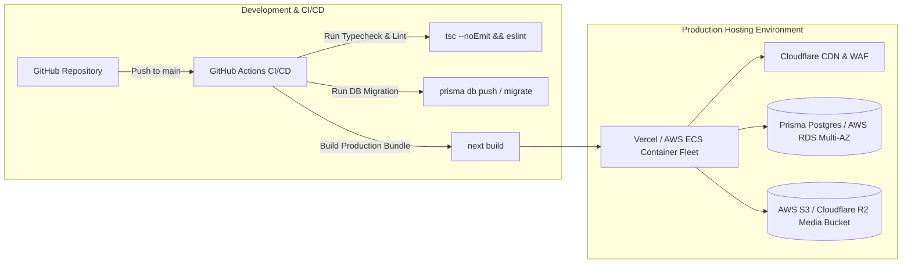

### Summary of Architecture Benefits
1. **Guaranteed Financial Integrity**: Immediate upfront balance locking ensures parallel payouts execute cleanly with zero double-spend risk.
2. **Modular Micro-Layering**: Clear separation of concerns between Storefront UI, POD Fulfillment, Rewards/Vesting Engine, and Stealth Admin operations.
3. **Enterprise Resiliency**: Hybrid data layer (PostgreSQL primary with automatic JSON state snapshot fallback) provides 100% development continuity and zero-downtime production deployment.
4. **Frictionless Scalability**: Ready for high-volume streetwear drops with CDN edge caching, connection pooling, and asynchronous background worker queues.
