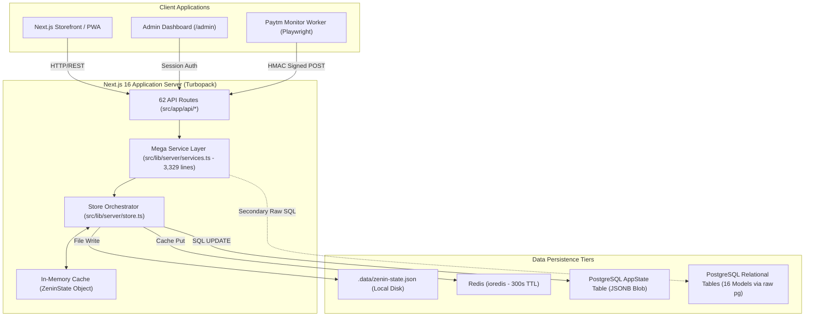
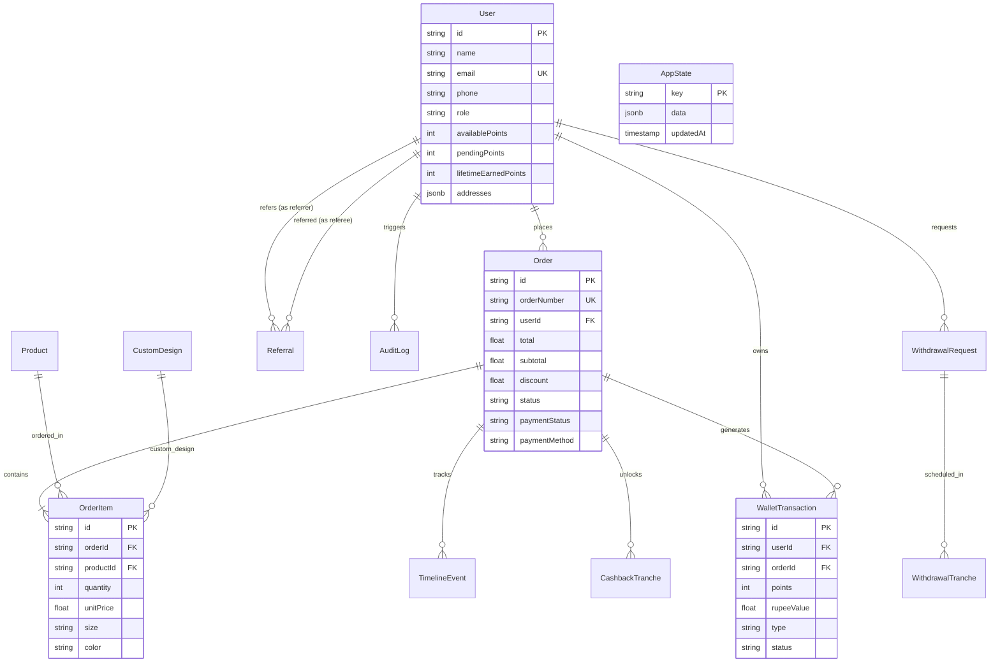

# SKYWEAR / ZENIN — Phase 1: Current Database Architecture

**Document Version:** 1.0  
**Scope:** Existing As-Is Architecture Documentation  

---

## 1. System Overview & The Dual-Storage Model

The current architecture is a **Hybrid Dual-Store Monolith**:

---

## 2. As-Is Data Flow & Split-Brain Mechanism

Every state mutation in the current system flows through `src/lib/server/store.ts`:

1. **State Load:**
   - Attempt to read in-memory `zeninState`.
   - If stale or absent, query Redis cache.
   - If absent in Redis, query `AppState` table (`SELECT data FROM "AppState" WHERE key = 'zenin_state'`).
   - If Postgres fails, fallback to local disk `.data/zenin-state.json`.

2. **State Mutation:**
   - Functions in `src/lib/server/services.ts` mutate the JS object directly.
   - `mutate(updater)` increments `revision` integer.
   - Asynchronously triggers:
     - File write to `.data/zenin-state.json`.
     - Redis set with 300s TTL.
     - PostgreSQL update: `UPDATE "AppState" SET data = $1, "updatedAt" = NOW() WHERE key = 'zenin_state'`.

3. **Relational Synchronization (The Disconnect):**
   - Certain operations (like order placement or customer signup) attempt a secondary raw SQL `INSERT` into relational tables (`User`, `Order`, `OrderItem`).
   - If the relational query fails or is omitted (e.g. manual admin edits, state reconciliation scripts), the JSON blob changes while the relational table remains unchanged.
   - **Result:** Relational tables have 31 orders, while JSON state has only 13 orders. Relational tables have 33 products, while JSON state has 27 products.

---

## 3. Current Entity Relationship Diagram (As-Is Prisma Schema)

---

## 4. Current Service & API Architecture

The application backend comprises:
- **62 Route Handlers** in `src/app/api/`:
  - 24 Admin routes (`/api/admin/*`) protected by `readAdminSession()`.
  - 6 Auth routes (`/api/auth/*`) handling OTP and password logic.
  - 7 Payment routes supporting Razorpay, OwnPay, and Manual UPI with QR codes.
  - 4 Wallet & Withdrawal routes (`/api/wallet/*`, `/api/withdrawals`).
  - 6 Push notification & preview routes.
  - 5 Webhook, cron, and reconciliation routes.
- **Monolithic Service Layer:**
  - `src/lib/server/services.ts` contains **3,329 lines** covering all domains in a single file without domain boundary encapsulation.
- **Database Driver:**
  - Raw `pg` Connection Pool with automatic failover between pooled and direct connection strings.
  - Prisma client `@prisma/client` is imported in `package.json` but not used for business logic queries.

