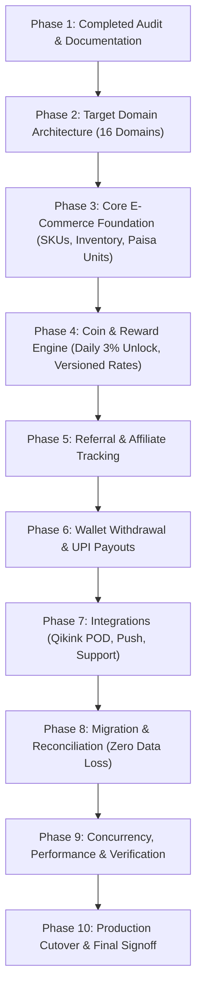
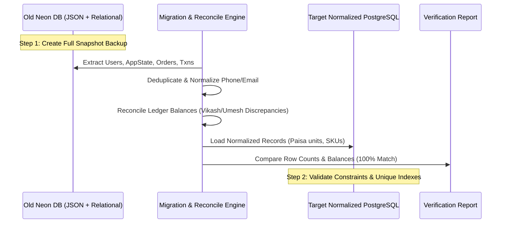

# SKYWEAR / ZENIN — Phase 1: Database Refactoring & Modernization Plan

**Document Version:** 1.0  
**Target:** Safe, Zero-Data-Loss Evolution from Hybrid JSON Store to Modular PostgreSQL Architecture  
**Execution Strategy:** Phased Modular Monolith  

---

## 1. Migration Principles & Guarantees

1. **Zero Data Loss Guarantee:** Every customer, order, line item, transaction, and address must be preserved and reconciled.
2. **Double-Entry Financial Accounting:** Eliminate float values; convert all financial figures to integer **paisa**; enforce append-only ledger entries.
3. **Single Source of Truth:** Decommission the JSON `AppState` blob in favor of fully normalized PostgreSQL relational tables.
4. **Independent Daily Unlock Engine:** Replace 4-week tranches with a per-grant independent daily 3% unlock schedule.
5. **Safe Phased Cutover:** Run dual-write validation and reconciliation scripts before decommissioning legacy tables.

---

## 2. Refactoring Phases Roadmap (Phases 2 – 17)

---

## 3. Target Domain Architecture (16 Modules)

The target relational schema organizes tables under clear business domains:

1. **Identity & Auth:** `users`, `auth_sessions`, `auth_otps`, `user_roles`, `user_addresses`.
2. **Customer:** `customer_profiles`, `customer_preferences`.
3. **Catalog:** `categories`, `brands`, `products`, `product_variants` (SKU, size, color, GSM), `product_images`.
4. **Inventory:** `inventory_items`, `stock_reservations`, `inventory_movements` (audit trail of stock in/out).
5. **Commerce & Orders:** `orders`, `order_items` (with pricing/product snapshots), `order_timeline_events`, `coupons`, `carts`, `cart_items`, `wishlists`.
6. **Payments:** `payment_transactions`, `payment_gateway_logs`, `manual_upi_submissions`.
7. **Fulfillment:** `pod_orders` (Qikink POD tracking), `shipments`, `shipping_labels`.
8. **Rewards & Wallet:** `wallets` (pending, available, locked buckets), `reward_rules`, `reward_grants` (independent daily unlock), `daily_unlock_schedules`, `wallet_journal` (double-entry ledger).
9. **Referrals:** `referrals`, `referral_milestones`, `referral_claims`.
10. **Payouts:** `withdrawal_requests`, `withdrawal_payout_logs`, `customer_bank_accounts`, `customer_upi_handles`.
11. **Notifications:** `in_app_notifications`, `web_push_subscriptions`, `notification_templates`.
12. **Support:** `support_tickets`, `ticket_messages`.
13. **Admin & RBAC:** `admin_users`, `admin_roles`, `admin_permissions`.
14. **Integrations:** `qikink_webhook_logs`, `razorpay_webhook_logs`, `paytm_reconciliation_logs`.
15. **Platform:** `app_settings` (versioned key-value store replacing AppState).
16. **Audit:** `immutable_audit_logs`.

---

## 4. Zero-Data-Loss Migration Pipeline (Phase 14 Strategy)

### Data Reconciliation Action Items:
1. **Unlinked Guest Orders:** Query all 25 guest orders, extract `customerPhone`, match to existing `User` or generate a corresponding customer profile, and update `Order.userId`.
2. **Vikash Patel Ledger Reconciliation:** Create an explicit balancing ledger entry (`ADMIN_ADJUSTMENT` / `HISTORICAL_RECONCILIATION`) accounting for the 20,250 points difference between `availablePoints` and historical journal rows.
3. **Umesh Patel Ledger Reconciliation:** Account for the 6,075 points discrepancy with a verifiable audit entry.
4. **Deleted Users Restoration:** Evaluate `DeletedUsersBin` records to re-link historical order snapshots so historical order integrity remains unbroken.
5. **Ghost Tables Pruning:** Safely drop empty duplicate lowercase tables `appstate` and `authotp`.

---

## 5. Risk Assessment & Rollback Strategy

| Risk | Likelihood | Impact | Mitigation Strategy |
|---|---|---|---|
| Historical Order Price Alteration | Low | Critical | Order items store fixed price snapshots (`unit_price_paisa`, `points_snapshot`); product catalog updates never touch historical order rows. |
| Negative Wallet Balances | Medium | High | Database `CHECK (available_coins >= 0)` constraint and transactional row-locking (`SELECT FOR UPDATE`). |
| Duplicate Daily Unlock | Medium | High | Unique index on `daily_unlock_schedules(grant_id, scheduled_date)` ensuring strict idempotency. |
| Downtime During Cutover | Low | Medium | Backward-compatible schema migration; staging validation prior to production traffic switch. |

