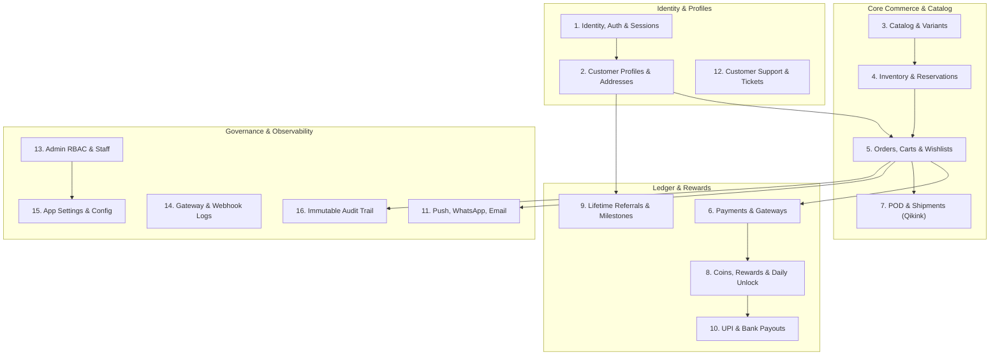

# SKYWEAR — Phase 2: Target Database Architecture & Domain Design

**Document Version:** 2.0  
**Architecture:** Modular Monolith on Single PostgreSQL Instance  
**Financial Standard:** Zero-Float Integer Accounting (`paisa` & `coins`)  
**Design Paradigm:** Domain-Driven Design (DDD) with Immutable Ledger & Event Audit  

---

## 1. Architectural Principles & Naming Conventions

### 1.1 Database Naming Conventions
- **Tables:** `snake_case`, pluralized (e.g., `orders`, `wallet_journal`, `product_variants`).
- **Columns:** `snake_case` (e.g., `unit_price_paisa`, `created_at`, `customer_id`).
- **Primary Keys:** Standardized `id UUID DEFAULT gen_random_uuid() PRIMARY KEY` or prefixed ULID/CUID text for distributed safety.
- **Foreign Keys:** `<singular_target_table>_id` with explicit `REFERENCES` and `ON DELETE RESTRICT` (default) or `ON DELETE CASCADE` where parent owns children (e.g., `order_items`).
- **Monetary Fields:** Strictly `BIGINT` representing **paisa** (₹1.00 = 100 paisa) or `NUMERIC(14, 2)`. Never `FLOAT` or `DOUBLE PRECISION`.
- **Reward Points / Coins:** Strictly `BIGINT` or `INTEGER` representing discrete whole coins.
- **Timestamps:** `TIMESTAMPTZ` (`TIMESTAMP WITH TIME ZONE`), default `NOW()`.

---

## 2. The 16 Target Business Domains



---

## 3. Detailed Schema Specification by Domain

### Domain 1: Identity & Authentication (`identity`)
```sql
-- Customers & Admins permanent identity
CREATE TABLE users (
    id VARCHAR(64) PRIMARY KEY, -- ULID / CUID (e.g. 'usr_01J...')
    phone VARCHAR(20) NOT NULL,
    phone_normalized VARCHAR(20) NOT NULL UNIQUE, -- E.164 (+919876543210)
    email VARCHAR(255) UNIQUE,
    password_hash VARCHAR(255), -- Argon2id or Scrypt
    role VARCHAR(32) NOT NULL DEFAULT 'CUSTOMER', -- 'CUSTOMER', 'ADMIN', 'SUPPORT'
    status VARCHAR(32) NOT NULL DEFAULT 'ACTIVE', -- 'ACTIVE', 'SUSPENDED', 'BLOCKED'
    created_at TIMESTAMPTZ NOT NULL DEFAULT NOW(),
    updated_at TIMESTAMPTZ NOT NULL DEFAULT NOW()
);

CREATE INDEX idx_users_phone ON users(phone_normalized);
CREATE INDEX idx_users_email ON users(email);

-- Persistent customer login sessions
CREATE TABLE auth_sessions (
    id VARCHAR(64) PRIMARY KEY,
    user_id VARCHAR(64) NOT NULL REFERENCES users(id) ON DELETE CASCADE,
    session_token_hash VARCHAR(128) NOT NULL UNIQUE,
    ip_address INET,
    user_agent TEXT,
    expires_at TIMESTAMPTZ NOT NULL,
    revoked_at TIMESTAMPTZ,
    created_at TIMESTAMPTZ NOT NULL DEFAULT NOW()
);

-- Transactional OTP verification
CREATE TABLE auth_otps (
    id VARCHAR(64) PRIMARY KEY,
    identifier VARCHAR(255) NOT NULL, -- phone or email
    otp_hash VARCHAR(128) NOT NULL, -- SHA-256 hash of OTP
    purpose VARCHAR(32) NOT NULL, -- 'LOGIN', 'SIGNUP', 'RESET_PASSWORD'
    attempts_count INT NOT NULL DEFAULT 0,
    max_attempts INT NOT NULL DEFAULT 3,
    is_verified BOOLEAN NOT NULL DEFAULT FALSE,
    expires_at TIMESTAMPTZ NOT NULL,
    created_at TIMESTAMPTZ NOT NULL DEFAULT NOW()
);
CREATE INDEX idx_auth_otps_identifier ON auth_otps(identifier, purpose);
```

### Domain 2: Customer Profiles & Addresses (`customer`)
```sql
CREATE TABLE customer_profiles (
    user_id VARCHAR(64) PRIMARY KEY REFERENCES users(id) ON DELETE CASCADE,
    first_name VARCHAR(100),
    last_name VARCHAR(100),
    avatar_url TEXT,
    tier VARCHAR(32) NOT NULL DEFAULT 'SILVER', -- 'SILVER', 'GOLD', 'PLATINUM'
    lifetime_spend_paisa BIGINT NOT NULL DEFAULT 0,
    total_orders_count INT NOT NULL DEFAULT 0,
    updated_at TIMESTAMPTZ NOT NULL DEFAULT NOW()
);

CREATE TABLE customer_addresses (
    id VARCHAR(64) PRIMARY KEY,
    user_id VARCHAR(64) NOT NULL REFERENCES users(id) ON DELETE CASCADE,
    is_default BOOLEAN NOT NULL DEFAULT FALSE,
    label VARCHAR(32) DEFAULT 'HOME', -- 'HOME', 'WORK', 'OTHER'
    recipient_name VARCHAR(128) NOT NULL,
    recipient_phone VARCHAR(20) NOT NULL,
    street_address TEXT NOT NULL,
    landmark TEXT,
    city VARCHAR(100) NOT NULL,
    state VARCHAR(100) NOT NULL,
    pincode VARCHAR(10) NOT NULL,
    country VARCHAR(64) NOT NULL DEFAULT 'India',
    created_at TIMESTAMPTZ NOT NULL DEFAULT NOW(),
    updated_at TIMESTAMPTZ NOT NULL DEFAULT NOW()
);
CREATE INDEX idx_customer_addresses_user ON customer_addresses(user_id);
```

### Domain 3: Catalog & Variants (`catalog`)
```sql
CREATE TABLE categories (
    id VARCHAR(64) PRIMARY KEY,
    slug VARCHAR(128) NOT NULL UNIQUE,
    name VARCHAR(128) NOT NULL,
    description TEXT,
    display_order INT NOT NULL DEFAULT 0,
    is_active BOOLEAN NOT NULL DEFAULT TRUE,
    created_at TIMESTAMPTZ NOT NULL DEFAULT NOW()
);

CREATE TABLE products (
    id VARCHAR(64) PRIMARY KEY,
    category_id VARCHAR(64) REFERENCES categories(id) ON DELETE SET NULL,
    slug VARCHAR(128) NOT NULL UNIQUE,
    title VARCHAR(255) NOT NULL,
    description TEXT,
    fabric VARCHAR(128) DEFAULT '100% Super Combed Cotton',
    gsm INT NOT NULL DEFAULT 240, -- Streetwear heavyweight 240 GSM
    base_price_paisa BIGINT NOT NULL, -- in paisa (e.g. 99900 = ₹999.00)
    mrp_paisa BIGINT NOT NULL, -- in paisa (e.g. 199900 = ₹1999.00)
    reward_coins_override INT, -- Custom fixed coins (e.g. 2000 coins)
    is_cod_available BOOLEAN NOT NULL DEFAULT TRUE,
    is_featured BOOLEAN NOT NULL DEFAULT FALSE,
    is_archived BOOLEAN NOT NULL DEFAULT FALSE,
    created_at TIMESTAMPTZ NOT NULL DEFAULT NOW(),
    updated_at TIMESTAMPTZ NOT NULL DEFAULT NOW()
);
CREATE INDEX idx_products_category ON products(category_id);
CREATE INDEX idx_products_slug ON products(slug);

CREATE TABLE product_variants (
    id VARCHAR(64) PRIMARY KEY,
    product_id VARCHAR(64) NOT NULL REFERENCES products(id) ON DELETE CASCADE,
    sku VARCHAR(64) NOT NULL UNIQUE, -- e.g. 'SKY-SOLO-BLK-OVR-L'
    size VARCHAR(32) NOT NULL, -- 'S', 'M', 'L', 'XL', '2XL', 'Oversized M', etc.
    color VARCHAR(64) NOT NULL, -- 'Midnight Black', 'Vintage Cream', etc.
    color_hex VARCHAR(16),
    price_override_paisa BIGINT, -- Optional variant price override
    pod_sku VARCHAR(64), -- Qikink POD partner SKU
    is_active BOOLEAN NOT NULL DEFAULT TRUE,
    created_at TIMESTAMPTZ NOT NULL DEFAULT NOW()
);
CREATE INDEX idx_variants_product ON product_variants(product_id);
CREATE INDEX idx_variants_sku ON product_variants(sku);
```

### Domain 4: Inventory & Stock Management (`inventory`)
```sql
CREATE TABLE inventory_items (
    variant_id VARCHAR(64) PRIMARY KEY REFERENCES product_variants(id) ON DELETE CASCADE,
    stock_on_hand INT NOT NULL DEFAULT 0,
    stock_reserved INT NOT NULL DEFAULT 0,
    stock_sold INT NOT NULL DEFAULT 0,
    low_stock_threshold INT NOT NULL DEFAULT 5,
    updated_at TIMESTAMPTZ NOT NULL DEFAULT NOW(),
    CONSTRAINT chk_stock_positive CHECK (stock_on_hand >= 0),
    CONSTRAINT chk_reserved_non_negative CHECK (stock_reserved >= 0)
);

CREATE TABLE stock_reservations (
    id VARCHAR(64) PRIMARY KEY,
    variant_id VARCHAR(64) NOT NULL REFERENCES product_variants(id),
    order_id VARCHAR(64),
    reserved_quantity INT NOT NULL,
    expires_at TIMESTAMPTZ NOT NULL, -- e.g. 15 minutes checkout lock
    status VARCHAR(32) NOT NULL DEFAULT 'RESERVED', -- 'RESERVED', 'COMMITTED', 'RELEASED'
    created_at TIMESTAMPTZ NOT NULL DEFAULT NOW()
);
CREATE INDEX idx_reservations_status_expires ON stock_reservations(status, expires_at);
```

### Domain 5: Commerce, Carts & Orders (`commerce`)
```sql
CREATE TABLE orders (
    id VARCHAR(64) PRIMARY KEY,
    order_number VARCHAR(32) NOT NULL UNIQUE, -- e.g. 'SKY-260124-789'
    user_id VARCHAR(64) NOT NULL REFERENCES users(id),
    status VARCHAR(32) NOT NULL DEFAULT 'PENDING', 
    -- 'PENDING', 'CONFIRMED', 'PRINTING_POD', 'SHIPPED', 'DELIVERED', 'CANCELLED', 'RETURNED'
    payment_status VARCHAR(32) NOT NULL DEFAULT 'PENDING', -- 'PENDING', 'PAID', 'REFUNDED', 'FAILED'
    payment_method VARCHAR(32) NOT NULL, -- 'RAZORPAY', 'OWNPAY', 'MANUAL_UPI', 'COD'
    subtotal_paisa BIGINT NOT NULL,
    discount_paisa BIGINT NOT NULL DEFAULT 0,
    shipping_fee_paisa BIGINT NOT NULL DEFAULT 0,
    tax_paisa BIGINT NOT NULL DEFAULT 0,
    total_paisa BIGINT NOT NULL,
    coins_redeemed INT NOT NULL DEFAULT 0,
    coins_redeemed_value_paisa BIGINT NOT NULL DEFAULT 0,
    coins_earned_projected INT NOT NULL DEFAULT 0,
    shipping_address_snapshot JSONB NOT NULL,
    placed_at TIMESTAMPTZ NOT NULL DEFAULT NOW(),
    updated_at TIMESTAMPTZ NOT NULL DEFAULT NOW()
);
CREATE INDEX idx_orders_user ON orders(user_id);
CREATE INDEX idx_orders_number ON orders(order_number);
CREATE INDEX idx_orders_status ON orders(status, placed_at);

-- Immutable line items storing snapshot of product data at purchase time
CREATE TABLE order_items (
    id VARCHAR(64) PRIMARY KEY,
    order_id VARCHAR(64) NOT NULL REFERENCES orders(id) ON DELETE CASCADE,
    product_id VARCHAR(64) NOT NULL REFERENCES products(id),
    variant_id VARCHAR(64) NOT NULL REFERENCES product_variants(id),
    sku_snapshot VARCHAR(64) NOT NULL,
    product_title_snapshot VARCHAR(255) NOT NULL,
    size_snapshot VARCHAR(32) NOT NULL,
    color_snapshot VARCHAR(64) NOT NULL,
    unit_price_paisa BIGINT NOT NULL,
    quantity INT NOT NULL CHECK (quantity > 0),
    total_item_paisa BIGINT NOT NULL,
    cashback_coins_snapshot INT NOT NULL DEFAULT 0
);
CREATE INDEX idx_order_items_order ON order_items(order_id);
```

### Domain 8: Custom Coin & Reward System (`rewards`)
```sql
-- Single customer wallet with segmented balance buckets
CREATE TABLE customer_wallets (
    user_id VARCHAR(64) PRIMARY KEY REFERENCES users(id) ON DELETE CASCADE,
    available_coins BIGINT NOT NULL DEFAULT 0,
    pending_coins BIGINT NOT NULL DEFAULT 0,
    locked_coins BIGINT NOT NULL DEFAULT 0,
    lifetime_earned_coins BIGINT NOT NULL DEFAULT 0,
    lifetime_withdrawn_coins BIGINT NOT NULL DEFAULT 0,
    updated_at TIMESTAMPTZ NOT NULL DEFAULT NOW(),
    CONSTRAINT chk_available_non_negative CHECK (available_coins >= 0),
    CONSTRAINT chk_pending_non_negative CHECK (pending_coins >= 0)
);

-- Versioned coin conversion rules (e.g. 1 coin = 1 paisa; 100 coins = ₹1)
CREATE TABLE coin_conversion_rules (
    id VARCHAR(64) PRIMARY KEY,
    paisa_per_coin NUMERIC(10, 4) NOT NULL DEFAULT 1.0000, -- 1 coin = 1 paisa
    minimum_withdrawal_coins INT NOT NULL DEFAULT 1000,
    daily_unlock_rate_pct NUMERIC(5, 2) NOT NULL DEFAULT 3.00, -- 3.00% daily
    is_active BOOLEAN NOT NULL DEFAULT TRUE,
    effective_from TIMESTAMPTZ NOT NULL DEFAULT NOW(),
    effective_until TIMESTAMPTZ
);

-- Independent reward grants (each grant has its own unlock schedule)
CREATE TABLE reward_grants (
    id VARCHAR(64) PRIMARY KEY,
    user_id VARCHAR(64) NOT NULL REFERENCES users(id),
    order_id VARCHAR(64) REFERENCES orders(id),
    source_type VARCHAR(32) NOT NULL, -- 'PURCHASE_CASHBACK', 'REFERRAL_COMMISSION', 'ADMIN_BONUS'
    original_coins INT NOT NULL CHECK (original_coins > 0),
    unlocked_coins INT NOT NULL DEFAULT 0,
    remaining_locked_coins INT NOT NULL,
    daily_unlock_rate_pct NUMERIC(5, 2) NOT NULL DEFAULT 3.00,
    conversion_rate_snapshot NUMERIC(10, 4) NOT NULL, -- paisa per coin snapshot
    status VARCHAR(32) NOT NULL DEFAULT 'ACTIVE', -- 'ACTIVE', 'COMPLETED', 'PAUSED', 'REVOKED'
    starts_at TIMESTAMPTZ NOT NULL DEFAULT NOW(),
    completed_at TIMESTAMPTZ,
    created_at TIMESTAMPTZ NOT NULL DEFAULT NOW()
);
CREATE INDEX idx_grants_user_status ON reward_grants(user_id, status);

-- Daily unlock schedule (strictly idempotent per grant per date)
CREATE TABLE daily_unlock_schedules (
    id VARCHAR(64) PRIMARY KEY,
    grant_id VARCHAR(64) NOT NULL REFERENCES reward_grants(id) ON DELETE CASCADE,
    scheduled_date DATE NOT NULL,
    coins_to_unlock INT NOT NULL,
    status VARCHAR(32) NOT NULL DEFAULT 'PENDING', -- 'PENDING', 'EXECUTED', 'SKIPPED'
    executed_at TIMESTAMPTZ,
    created_at TIMESTAMPTZ NOT NULL DEFAULT NOW(),
    CONSTRAINT uq_grant_scheduled_date UNIQUE (grant_id, scheduled_date)
);
CREATE INDEX idx_unlock_date_status ON daily_unlock_schedules(scheduled_date, status);

-- Double-Entry Immutable Wallet Journal
CREATE TABLE wallet_journal (
    id VARCHAR(64) PRIMARY KEY,
    user_id VARCHAR(64) NOT NULL REFERENCES users(id),
    grant_id VARCHAR(64) REFERENCES reward_grants(id),
    order_id VARCHAR(64) REFERENCES orders(id),
    entry_type VARCHAR(32) NOT NULL, -- 'CREDIT_AVAILABLE', 'DEBIT_AVAILABLE', 'CREDIT_PENDING', 'UNLOCK_TRANSFER'
    coins INT NOT NULL,
    balance_after_coins BIGINT NOT NULL,
    reference_id VARCHAR(128) NOT NULL, -- Idempotency key
    narration TEXT NOT NULL,
    created_at TIMESTAMPTZ NOT NULL DEFAULT NOW(),
    CONSTRAINT uq_wallet_journal_ref UNIQUE (reference_id)
);
CREATE INDEX idx_wallet_journal_user ON wallet_journal(user_id, created_at);
```

### Domain 9: Lifetime Referral System (`referrals`)
```sql
CREATE TABLE referrals (
    id VARCHAR(64) PRIMARY KEY,
    referrer_id VARCHAR(64) NOT NULL REFERENCES users(id),
    referee_id VARCHAR(64) NOT NULL UNIQUE REFERENCES users(id), -- A referee can only have 1 permanent referrer
    referral_code_used VARCHAR(32) NOT NULL,
    status VARCHAR(32) NOT NULL DEFAULT 'QUALIFIED', -- 'QUALIFIED', 'CONVERTED'
    total_commission_coins_earned BIGINT NOT NULL DEFAULT 0,
    created_at TIMESTAMPTZ NOT NULL DEFAULT NOW(),
    CONSTRAINT chk_no_self_referral CHECK (referrer_id != referee_id)
);
CREATE INDEX idx_referrals_referrer ON referrals(referrer_id);

CREATE TABLE referral_milestones (
    id VARCHAR(64) PRIMARY KEY,
    required_referrals INT NOT NULL UNIQUE,
    reward_title VARCHAR(255) NOT NULL, -- 'Washing Machine (10 Referrals)', 'iPhone 17 Pro Max (100 Referrals)'
    reward_description TEXT,
    is_active BOOLEAN NOT NULL DEFAULT TRUE
);

CREATE TABLE referral_milestone_claims (
    id VARCHAR(64) PRIMARY KEY,
    user_id VARCHAR(64) NOT NULL REFERENCES users(id),
    milestone_id VARCHAR(64) NOT NULL REFERENCES referral_milestones(id),
    status VARCHAR(32) NOT NULL DEFAULT 'PENDING_REVIEW', -- 'PENDING_REVIEW', 'APPROVED', 'DISPATCHED', 'REJECTED'
    admin_notes TEXT,
    dispatched_at TIMESTAMPTZ,
    created_at TIMESTAMPTZ NOT NULL DEFAULT NOW(),
    CONSTRAINT uq_user_milestone UNIQUE (user_id, milestone_id)
);
```

### Domain 10: Wallet Withdrawal & Payouts (`payouts`)
```sql
CREATE TABLE withdrawal_requests (
    id VARCHAR(64) PRIMARY KEY,
    user_id VARCHAR(64) NOT NULL REFERENCES users(id),
    requested_coins BIGINT NOT NULL,
    rupee_amount_paisa BIGINT NOT NULL,
    payout_method VARCHAR(32) NOT NULL, -- 'UPI', 'BANK_ACCOUNT'
    payout_details JSONB NOT NULL, -- { upiId: 'user@okhdfcbank' } or bank details
    status VARCHAR(32) NOT NULL DEFAULT 'PENDING', 
    -- 'PENDING', 'PROCESSING', 'PAID', 'REJECTED', 'FAILED'
    utr_reference VARCHAR(64),
    rejection_reason TEXT,
    processed_by_admin_id VARCHAR(64) REFERENCES users(id),
    processed_at TIMESTAMPTZ,
    created_at TIMESTAMPTZ NOT NULL DEFAULT NOW()
);
CREATE INDEX idx_withdrawals_user_status ON withdrawal_requests(user_id, status);
```

---

## 4. Data Ownership & Concurrency Guarantees

1. **Transactional Row Locking on Wallets:**
   All balance deductions (checkout coin redemption, withdrawal request) must perform:
   ```sql
   SELECT available_coins, pending_coins FROM customer_wallets WHERE user_id = $1 FOR UPDATE;
   ```
2. **Idempotency Keys:**
   Every payment webhook, daily unlock run, and withdrawal payout requires a unique idempotency key registered in `reference_id` or dedicated gateway log.
3. **Optimistic Locking:**
   State mutations on high-traffic rows incorporate `updated_at` checks or version numbers (`version INT NOT NULL DEFAULT 1`).

